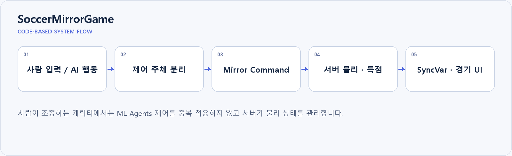

# SoccerMirrorGame

**학습된 AI와 사람이 함께 플레이하는 Unity 네트워크 축구**

학습된 ML-Agents 캐릭터와 네트워크 플레이어가 한 경기에서 동작하도록 연결한 교육용 프로젝트입니다.

2026.01 라오스 교육 준비·멘토링 | Unity Soccer 예제 기반 확장  
`Unity · C# · ML-Agents · Mirror · Rigidbody · Command · SyncVar`

## 본인 기여

교육용 축구 게임을 준비하고 프로젝트 구조와 확장 방법을 멘토링했습니다. AI와 사람의 제어 경로, 서버 물리와 경기 상태 동기화를 다뤘습니다. Unity의 기존 Soccer 예제를 기반으로 확장한 프로젝트입니다.

## 기술 구조

| 구성 | 구현 내용 |
|---|---|
| AI · 사람 제어 분리 | AgentSoccer의 OnActionReceived와 사람 조종 경로를 구분합니다. 플레이어에게 캐릭터를 할당할 때 ML-Agents 컴포넌트를 비활성화해 입력이 충돌하지 않게 구성했습니다. |
| 서버 중심 물리 처리 | NetPlayerInput의 Command로 이동·회전 입력을 서버에 보내고 Rigidbody를 갱신합니다. 공은 서버에서 물리를 계산하고 원격 클라이언트에서는 중복 계산을 끕니다. |
| 경기 상태 동기화 | Waiting·Playing·GameOver 상태와 점수를 SyncVar로 공유합니다. 조종 대상 netId와 카메라 추적 대상을 연결하며 PC·모바일 입력 경로를 제공합니다. |
| 기술 교육 적용 | 현지 학생의 수준에 맞춰 Unity 기초, 게임 구조·확장, GitHub 활용으로 교육 목표를 조정했습니다. AI 생성 텍스트 판별 프로젝트 멘토링도 함께 진행했습니다. |

## 구현 결과와 확인 범위

멘토링한 현지 팀이 최종 발표 1위를 기록했습니다. 학생들은 질문하고 직접 게임 기능을 바꿔보는 방식으로 참여했습니다.

강화학습 알고리즘이나 Soccer 예제 전체를 새로 개발한 성과로 주장하지 않습니다. 현지 교육은 기초 수준에 맞춰 진행했으며 고급 학습·네트워크 기능 전체를 교육했다고 해석하지 않습니다.

## 코드와 실행

[AI 행동 처리](Assets/ML-Agents/Examples/Soccer/Scripts/AgentSoccer.cs) · [입력 · Command](Assets/ML-Agents/Examples/Soccer/Scripts/ADD/NetPlayerInput.cs) · [서버 물리](Assets/ML-Agents/Examples/Soccer/Scripts/ADD/SoccerBallNetworkPhysics.cs) · [경기 상태](Assets/ML-Agents/Examples/Soccer/Scripts/ADD/GameManager.cs)

Unity 프로젝트를 열어 Soccer 씬과 NetworkManager 설정을 확인합니다. 사용 버전과 장면은 `ProjectSettings/ProjectVersion.txt`, `Assets/ML-Agents/Examples/Soccer/`를 기준으로 확인합니다.

화면·구성도는 설명을 위한 자료이며, 구성도는 현재 코드의 처리 흐름을 정리한 것입니다. 실험 수치와 본인 기여 범위는 위에 명시한 기준으로 해석합니다.
